<div style="font-family: 'Times New Roman', Times, serif;">

# ParkSphere — Smart Parking Management & Bay Reservation Platform

<p align="center">
  
  
  
  
  
  
</p>

<div align="center">

| Operational Resource | Specification / Status |
| :--- | :--- |
| **Local Web Service** | `http://localhost:5000` |
| **Operational Health API** | `Operational — HTTP 200 OK (/health)` |
| **Database Cluster** | `MongoDB Atlas Cloud / Local MongoDB Failover (mongodb://127.0.0.1:27017/parksphere)` |
| **Concurrency Safeguard** | `Database-Level Interval Overlap Validation + Compound Temporal Indexing` |
| **Visual Aesthetics** | `Minimalist Luxury: Obsidian Black (#111111) & Crisp White (#FFFFFF)` |
| **Typography Standard** | `Universal Georgia / Times New Roman Serif across all components` |

</div>

---

## Table of Contents
1. [Executive Summary](#executive-summary)
2. [Core Application Showcase](#core-application-showcase)
3. [System Architecture & MVC Implementation](#system-architecture--mvc-implementation)
4. [Engineering Deep-Dives](#engineering-deep-dives)
   - [1. Atomic Concurrency & Double-Booking Elimination](#1-atomic-concurrency--double-booking-elimination)
   - [2. Parking Session Lifecycle & Authoritative Billing](#2-parking-session-lifecycle--authoritative-billing)
   - [3. Resilient Email OTP Verification Pipeline](#3-resilient-email-otp-verification-pipeline)
   - [4. Regional Multi-Currency Formatting Engine](#4-regional-multi-currency-formatting-engine)
   - [5. Role-Based Access Control & Persistent Session Architecture](#5-role-based-access-control--persistent-session-architecture)
5. [Database Modeling & Schema Architecture](#database-modeling--schema-architecture)
6. [RESTful API Specification](#restful-api-specification)
7. [Directory Structure](#directory-structure)
8. [Local Setup & Environment Configuration](#local-setup--environment-configuration)
9. [Author & License](#author--license)

---

## Executive Summary

**ParkSphere** is an enterprise-grade Smart Parking Management and Bay Reservation Platform built on the Node.js / Express / MongoDB stack. It is engineered to solve urban parking congestion, bay allocation contention, and gate management inefficiency through clean software architecture.

Built following strict Model-View-Controller (MVC) design principles and styled with clean Obsidian Black and Crisp White aesthetics with Georgia / Times New Roman typography, ParkSphere unifies three critical operational roles into a single high-performance system:
* **Customers (Drivers)**: Seamlessly discover facilities across metropolitan areas (Delhi NCR, Bengaluru, Mumbai, London, New York), filter by EV charging or vehicle dimension, register vehicles, and reserve guaranteed bays.
* **Operators (Gatekeepers)**: Supervise physical garage queues, stamp vehicle entry/exit with authoritative hardware-like timestamps, monitor live bay occupancies, and toggle slot maintenance modes in real time.
* **Administrators (Platform Executives)**: Inspect system-wide capacity, active revenue, user growth metrics, and audit logs.

### Key Technical Differentiators
* **Atomic Concurrency Protection**: Completely eliminates double-booking race conditions during high-concurrency demand spikes using database-level temporal interval overlap detection and compound indexing.
* **Multi-Currency Localization**: Automatically formats hourly and total booking rates using locale-aware currency symbols (`₹` for India, `$` for USA, `£` for UK, `€` for Europe, `AED` for UAE, `S$` for Singapore, `¥` for Japan).
* **Zero-Crash Email Pipeline**: Transports 6-digit cryptographic verification OTPs over Nodemailer SMTP with automatic development console fallback, ensuring unblocked workflows even when offline.
* **Authoritative Billing Computation**: Calculates parking tariffs based on true physical check-in and check-out timestamps rather than user-estimated intervals.

---

## Core Application Showcase

<div align="center">

| Explore Parking Catalog & Live Tax Display | Facility Details & Real-Time Bay Reservation |
| :---: | :---: |
| 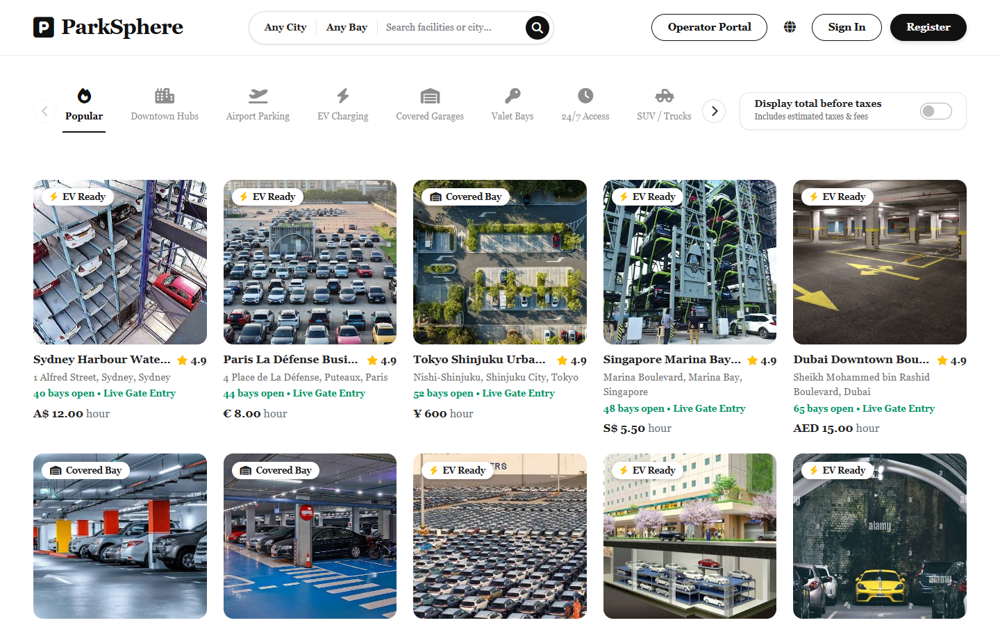 | 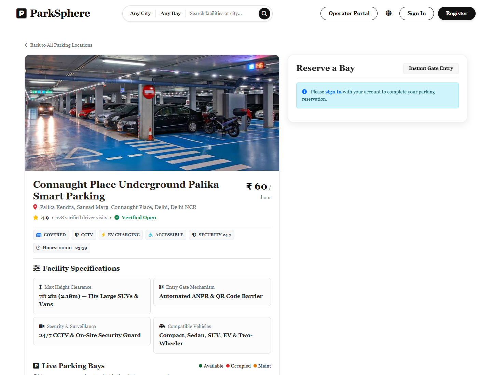 |
| *City search capsule, amenities filters, multi-currency hourly rates & tax toggle* | *Interactive slot grid (Compact, Sedan, SUV, EV), pricing breakdown & booking modal* |

| Search by Metropolitan City (e.g. Delhi NCR) | Customer Bookings & Check-Out Terminal |
| :---: | :---: |
| 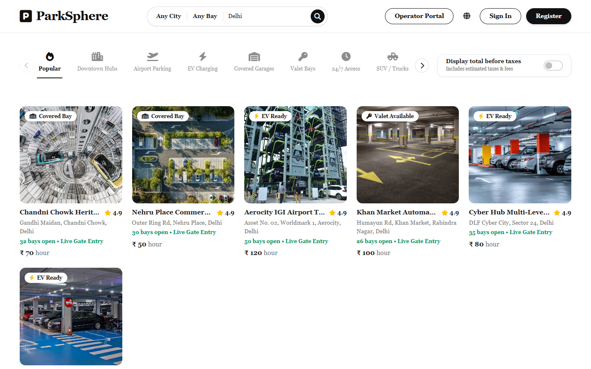 | 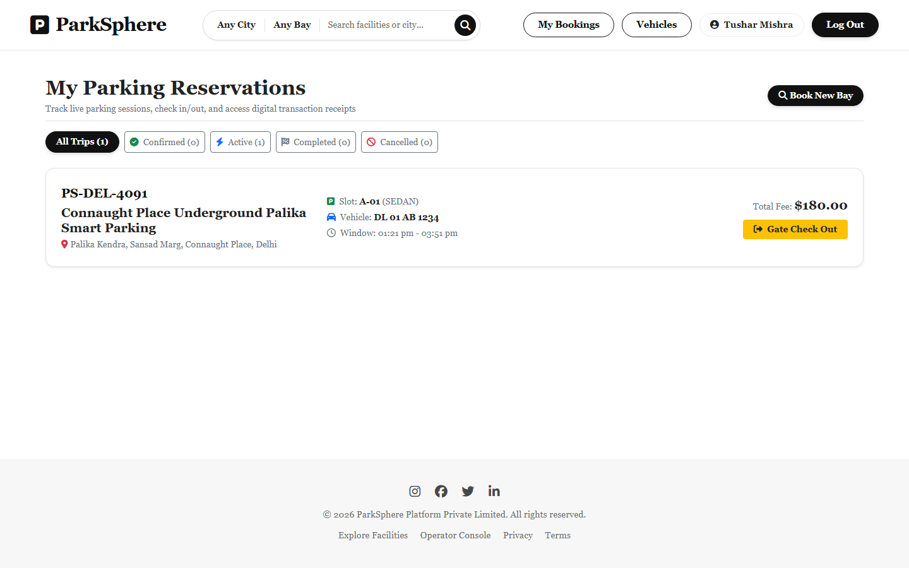 |
| *Real-time keyword filtering across Indian and international locations with INR pricing* | *Active parking sessions, booking codes, vehicle tags, and one-click exit settlement* |

| Operator Live Gate Queue & Check-In Console | Operator Bay Inventory & Maintenance Control |
| :---: | :---: |
| 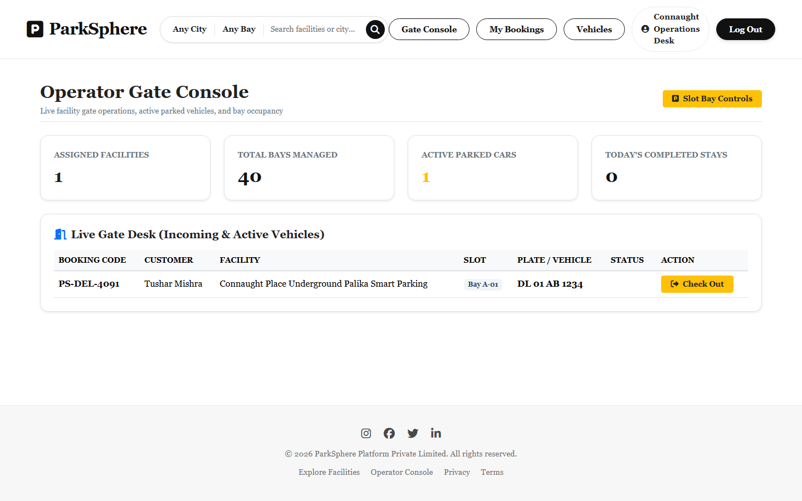 | 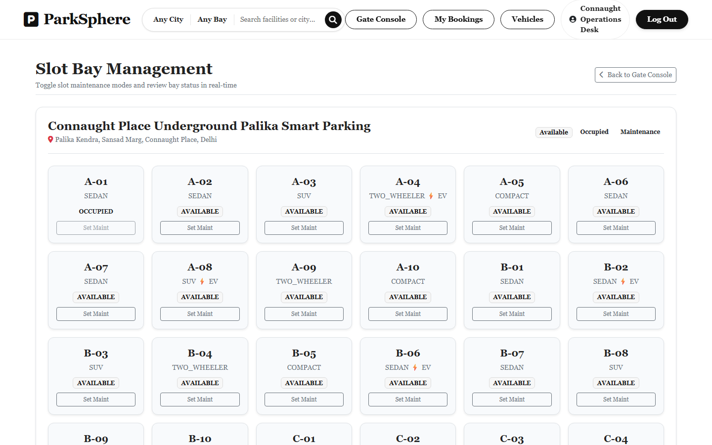 |
| *Incoming driver queue, booking code verification, physical check-in & check-out stamps* | *Real-time bay status indicators, slot statistics & maintenance toggle actions* |

</div>

<details>
<summary><b>View Additional Application Interfaces (Authentication & Vehicle Management)</b></summary>
<br>
<div align="center">

| User Registration & Role Onboarding | User Sign-In Interface |
| :---: | :---: |
| 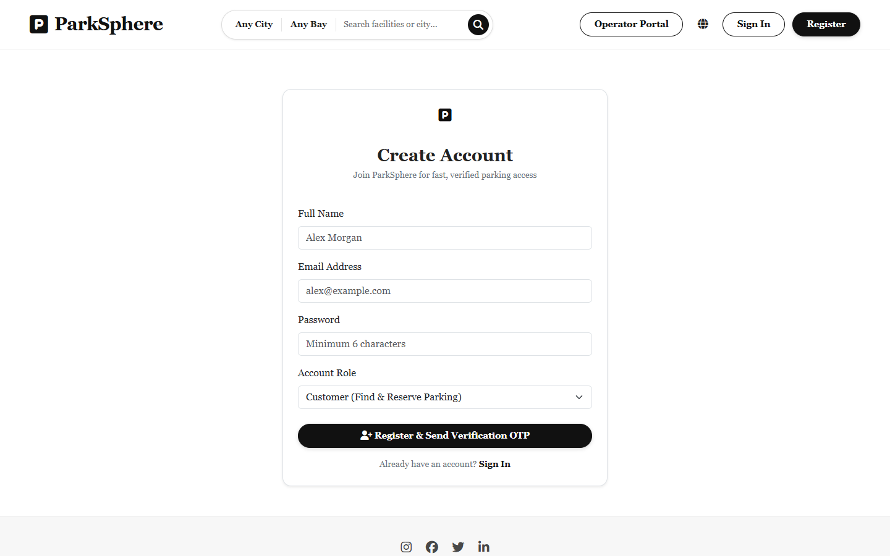 | 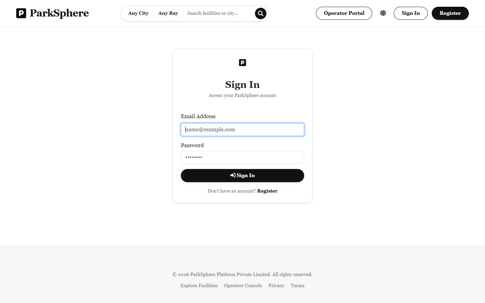 |
| *Name, email, password hashing, and role selection* | *Streamlined login interface with session preservation* |

| 6-Digit Email OTP Verification | Customer Registered Vehicles Management |
| :---: | :---: |
| 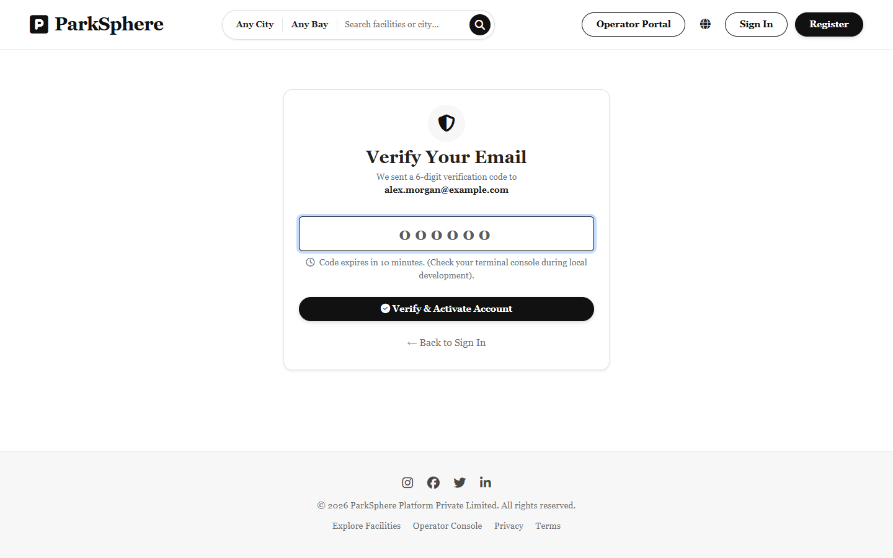 | 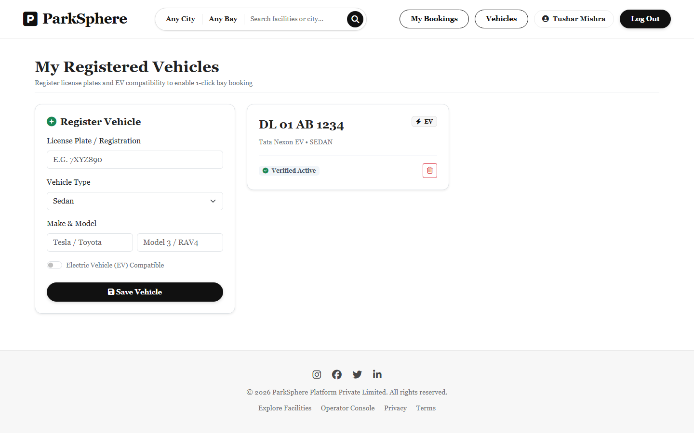 |
| *10-minute expiry countdown, resend cooldown & secure activation* | *License plate registry, vehicle type tags & EV compatibility indicators* |

</div>
</details>

---

## System Architecture & MVC Implementation

ParkSphere follows a strict Model-View-Controller architecture, cleanly isolating routing, request validation, domain logic, data models, and user presentation.

<div align="center">

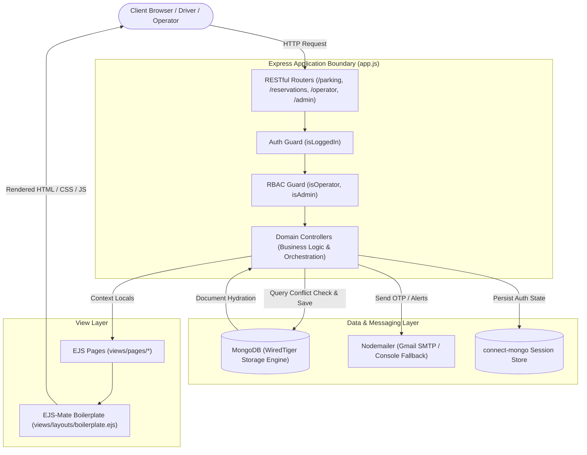

</div>

### Architectural Highlights
1. **Separation of Concerns**: Controllers (`controllers/*.js`) contain zero presentation markup and zero direct HTTP routing logic. Routers (`routes/*.js`) map routes and apply middleware chains.
2. **Asynchronous Wrapper (`wrapAsync`)**: Eliminates boilerplate try-catch blocks across all controllers. Unhandled rejected promises are caught and piped directly to the central Express error-handling middleware.
3. **Template Composition**: Built using `ejs-mate` master layouts (`views/layouts/boilerplate.ejs`), partials (`navbar.ejs`, `footer.ejs`, `flash.ejs`), and dedicated role-based view folders (`pages/customer/`, `pages/operator/`, `pages/admin/`, `pages/parking/`).
4. **Universal Typography & Styling**: Custom CSS tokens in `public/css/style.css` enforce the Obsidian Black (`#111111`) and Crisp White (`#FFFFFF`) palette with Georgia / Times New Roman typography across all pages.

---

## Engineering Deep-Dives

### 1. Atomic Concurrency & Double-Booking Elimination

* **The Problem**: When hundreds of drivers attempt to book the same prime parking bay during peak demand windows (e.g. airport or stadium parking), traditional "Check-Then-Insert" approaches cause a classic race condition:
  1. Thread A checks bay availability at 10:00:00 AM -> Available.
  2. Thread B checks bay availability at 10:00:01 AM -> Available.
  3. Thread A reserves the bay and commits.
  4. Thread B reserves the bay and commits.
  5. **Result**: Catastrophic double-booking and physical lot gridlock.

* **The ParkSphere Solution**: Rigorous database-level conflict detection:
  1. **Temporal Interval Intersect Validation**: When a customer submits a reservation, the server executes an interval overlap check against existing active bookings (`CONFIRMED`, `ACTIVE`, `PENDING`):
     $$\text{Overlap Condition: } (\text{existing.startTime} < \text{requestedEnd}) \land (\text{existing.endTime} > \text{requestedStart})$$
     ```javascript
     // Direct database-level collision query
     const existingConflict = await Reservation.findOne({
       slot: targetSlot._id,
       status: { $in: ['CONFIRMED', 'ACTIVE', 'PENDING'] },
       startTime: { $lt: requestedEnd },
       endTime: { $gt: requestedStart },
     });

     if (existingConflict) {
       req.flash('error', `Bay ${targetSlot.slotNumber} is already reserved for this window.`);
       return res.redirect(`/parking/${facilityId}`);
     }
     ```
  2. **Compound Temporal Indexing**: A high-performance compound index on `{ slot: 1, startTime: 1, endTime: 1, status: 1 }` enables MongoDB to execute time-interval overlap evaluations in sub-millisecond execution times.

---

### 2. Parking Session Lifecycle & Authoritative Billing

Reservations progress through a formal, auditable state machine:

<div align="center">

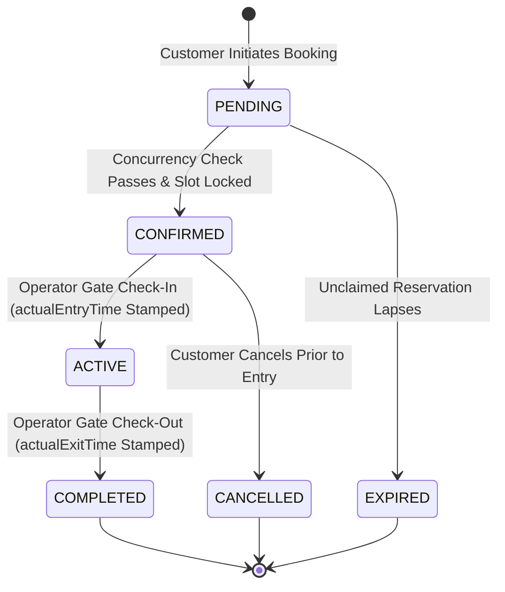

</div>

* **Authoritative Timestamping**: Unlike systems that charge customers based on their planned reservation times, ParkSphere records physical `actualEntryTime` and `actualExitTime` during gatekeeper operations.
* **Tariff Calculation**: The final billing amount is computed authoritatively at check-out:
  $$\text{Hours} = \max\left(1, \left\lceil \frac{\text{actualExitTime} - \text{actualEntryTime}}{3600 \times 1000} \right\rceil\right)$$
  $$\text{Total Fee} = \text{Hours} \times \text{Facility Hourly Rate}$$

---

### 3. Resilient Email OTP Verification Pipeline

* **Cryptographic OTP Generation**: Accounts are created with a 6-digit random token and a 10-minute expiry window (`Date.now() + 10 * 60 * 1000`).
* **Dual-Mode Dispatcher (`utils/mailer.js`)**:
  * **Production Mode**: Connects to SMTP (e.g. Gmail SMTP) to deliver professional HTML emails.
  * **Development / Offline Fallback**: If SMTP credentials are not configured or if an external network outage occurs, the system captures the event and outputs the OTP directly to the terminal console without throwing unhandled exceptions or disrupting user onboarding.

---

### 4. Regional Multi-Currency Formatting Engine

ParkSphere dynamically formats rates and totals based on the facility's geographical country:

```javascript
res.locals.formatPrice = (amount, currency = 'INR') => {
  const value = Number(amount || 0);
  const currencySymbols = {
    INR: '₹', USD: '$', GBP: '£', EUR: '€',
    AED: 'AED', SGD: 'S$', JPY: '¥', AUD: 'A$'
  };
  const symbol = currencySymbols[currency] || '₹';
  return (symbol === '₹' || symbol === '¥')
    ? `${symbol} ${Math.round(value)}`
    : `${symbol} ${value.toFixed(2)}`;
};
```

---

### 5. Role-Based Access Control & Persistent Session Architecture

* **Persistent Sessions (`connect-mongo`)**: User sessions are backed by MongoDB via `connect-mongo`, enabling transparent server restarts, multi-instance scalability, and a 7-day session lifetime.
* **Return-URL Preservation**: When an unauthenticated visitor attempts to book a bay, `isLoggedIn` captures `req.originalUrl` in the session. Once logged in, the user is seamlessly returned to their intended facility page.
* **Role Verification Middleware**:
  * `isLoggedIn`: Ensures active user session.
  * `isOperator`: Restricts access to gate operations (`role: 'OPERATOR'` or `'ADMIN'`).
  * `isAdmin`: Enforces strict platform governance (`role: 'ADMIN'`).

---

## Database Modeling & Schema Architecture

The database is built on 8 interconnected Mongoose models designed for referential integrity and query speed:

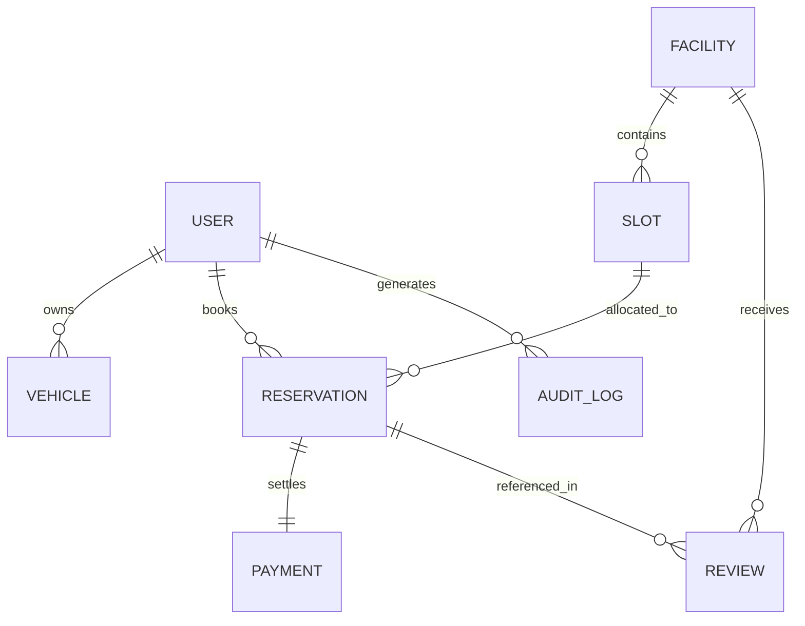

### Schema Summary
| Model | Key Fields | Purpose & Indexes |
| :--- | :--- | :--- |
| **User** (`models/user.js`) | `name`, `email`, `password`, `role`, `isEmailVerified`, `otp` | Stores driver & operator accounts. Unique index on `email`. Bcrypt password comparison. |
| **Facility** (`models/facility.js`) | `name`, `address`, `city`, `coordinates`, `pricing`, `operatingHours`, `amenities`, `operator` | Represents garages/lots. Compound index on `{ city: 1, isActive: 1 }`. |
| **Slot** (`models/slot.js`) | `facility`, `slotNumber`, `slotType`, `isEV`, `status` | Individual bays. Compound unique index on `{ facility: 1, slotNumber: 1 }`. |
| **Reservation** (`models/reservation.js`) | `bookingCode`, `user`, `facility`, `slot`, `vehicle`, `startTime`, `endTime`, `actualEntryTime`, `actualExitTime`, `status` | Core booking contract. Compound index on `{ slot: 1, startTime: 1, endTime: 1, status: 1 }` and `{ user: 1, createdAt: -1 }`. |
| **Vehicle** (`models/vehicle.js`) | `user`, `registrationNumber`, `vehicleType`, `isEV`, `make`, `model` | Customer vehicles. Unique index on `registrationNumber`. |
| **Payment** (`models/payment.js`) | `reservation`, `user`, `amount`, `method`, `status`, `transactionId` | Financial transaction audit ledger. Unique index on `transactionId`. |
| **Review** (`models/review.js`) | `facility`, `user`, `reservation`, `rating`, `comment` | Customer feedback and 1-5 star ratings. Indexed on `facility`. |
| **AuditLog** (`models/auditLog.js`) | `actor`, `action`, `entityType`, `entityId`, `metadata`, `timestamp` | Security and compliance logs for gate entries and slot changes. |

---

## RESTful API Specification

### 1. Public & Parking Discovery Routes (`routes/parking.js`)
| Method | Endpoint | Access | Purpose |
| :--- | :--- | :--- | :--- |
| `GET` | `/` | Public | Redirects directly to `/parking` explore catalog |
| `GET` | `/parking` | Public | Explore catalog with city search, category filter, and tax toggle |
| `GET` | `/parking/new` | Operator/Admin | Renders facility creation form |
| `POST` | `/parking` | Operator/Admin | Creates a new parking facility |
| `GET` | `/parking/:id` | Public | Displays facility details, pricing, amenities, and bay grid |
| `GET` | `/parking/:id/edit` | Operator/Admin | Renders facility update form |
| `PUT` | `/parking/:id` | Operator/Admin | Updates facility metadata and pricing |
| `DELETE`| `/parking/:id` | Admin | Soft-deletes or removes facility |

### 2. Authentication & Verification Routes (`routes/auth.js`)
| Method | Endpoint | Access | Purpose |
| :--- | :--- | :--- | :--- |
| `GET` | `/register` | Public | Renders registration form |
| `POST` | `/register` | Public | Creates account and dispatches 6-digit OTP |
| `GET` | `/verify-otp` | Public | Renders email OTP verification form |
| `POST` | `/verify-otp` | Public | Validates OTP and activates user account |
| `GET` | `/login` | Public | Renders sign-in form |
| `POST` | `/login` | Public | Authenticates credentials and starts session |
| `GET` | `/logout` | Authenticated | Destroys session and cleans authentication cookies |

### 3. Customer Operations (`routes/reservations.js`, `routes/vehicles.js`, `routes/users.js`)
| Method | Endpoint | Access | Purpose |
| :--- | :--- | :--- | :--- |
| `GET` | `/customer/dashboard` | Customer | Driver overview, active trips, and quick action cards |
| `GET` | `/customer/bookings` | Customer | Lists all confirmed, active, and past reservations |
| `POST` | `/reservations` | Customer | Executes mutex-locked bay reservation |
| `POST` | `/reservations/:id/cancel` | Customer | Cancels eligible upcoming booking |
| `GET` | `/customer/vehicles` | Customer | Lists customer vehicles and displays vehicle creation form |
| `POST` | `/customer/vehicles` | Customer | Registers a new vehicle with license plate & EV flag |
| `DELETE`| `/customer/vehicles/:id` | Customer | Removes a registered vehicle |

### 4. Operator Terminal Routes (`routes/operator.js`)
| Method | Endpoint | Access | Purpose |
| :--- | :--- | :--- | :--- |
| `GET` | `/operator/dashboard` | Operator | Live gate terminal displaying incoming queue and active bays |
| `POST` | `/operator/check-in` | Operator | Gate check-in stamping `actualEntryTime` |
| `POST` | `/operator/check-out` | Operator | Gate check-out calculating duration and collecting final fee |
| `GET` | `/operator/slots` | Operator | Real-time bay occupancy inventory grid |
| `POST` | `/operator/slots/:id/toggle` | Operator | Toggles slot between AVAILABLE and MAINTENANCE |

### 5. Platform Governance & Health (`routes/admin.js`, `app.js`)
| Method | Endpoint | Access | Purpose |
| :--- | :--- | :--- | :--- |
| `GET` | `/health` | Public | Operational status endpoint returning uptime and database health |
| `GET` | `/admin/dashboard` | Admin | High-level metrics: user counts, active facilities, bookings, slots |
| `GET` | `/admin/audit-logs` | Admin | Chronological forensic audit log viewer |

---

## Directory Structure

```
ParkSphere/
├── assets/                          # Application UI screenshots
│   ├── 01_explore_parking_catalog.png
│   ├── 02_facility_details_and_bay_booking.png
│   ├── 03_user_signup.png
│   ├── 04_user_signin.png
│   ├── 05_otp_verification.png
│   ├── 06_search_and_filters.png
│   ├── 07_customer_bookings.png
│   ├── 08_customer_vehicles.png
│   ├── 09_operator_dashboard.png
│   └── 10_operator_slot_management.png
├── controllers/                     # Domain business logic controllers
│   ├── admin.js
│   ├── auth.js
│   ├── operator.js
│   ├── parking.js
│   ├── reservations.js
│   ├── users.js
│   └── vehicles.js
├── init/                            # Database seed scripts & initial dataset
│   ├── data.js                      # 27 global facilities & 1,000+ slots
│   └── index.js                     # Automated seeding runner
├── models/                          # Mongoose ODM schemas & compound indexes
│   ├── auditLog.js
│   ├── facility.js
│   ├── payment.js
│   ├── reservation.js
│   ├── review.js
│   ├── slot.js
│   ├── user.js
│   └── vehicle.js
├── public/                          # Static web assets
│   ├── css/
│   │   ├── listings.css             # Catalog grid & search capsule styling
│   │   ├── navbar.css               # Navigation bar & dropdown menus
│   │   └── style.css                # Global design system & typography tokens
│   └── js/
│       └── script.js                # Client-side form validation scripts
├── routes/                          # Express RESTful route declarations
│   ├── admin.js
│   ├── auth.js
│   ├── operator.js
│   ├── parking.js
│   ├── reservations.js
│   ├── users.js
│   └── vehicles.js
├── utils/                           # Core utilities
│   ├── ExpressError.js              # Custom HTTP error class
│   ├── mailer.js                    # Nodemailer OTP emailer & console fallback
│   └── wrapAsync.js                 # Asynchronous promise exception wrapper
├── views/                           # Server-rendered EJS templates
│   ├── includes/                    # Partials: navbar, footer, flash alerts
│   ├── layouts/                     # Master boilerplate layout (ejs-mate)
│   └── pages/                       # Role-based views: auth, customer, operator, admin
├── .env.example                     # Environment configuration blueprint
├── app.js                           # Express application bootstrap & configuration
├── middleware.js                    # Authentication & RBAC middleware guards
├── package.json                     # Project manifest and scripts
└── README.md                        # Project documentation
```

---

## Local Setup & Environment Configuration

### Prerequisites
* **Node.js**: v18.x or v20.x or v24.x
* **MongoDB**: A local MongoDB instance (`mongodb://127.0.0.1:27017`) or a free [MongoDB Atlas](https://www.mongodb.com/cloud/atlas) cluster URI.

### 1. Clone & Install Dependencies
```bash
git clone https://github.com/tusharr-mishra/ParkSphere.git
cd ParkSphere
npm install
```

### 2. Configure Environment Variables
Create a `.env` file in the root directory (refer to `.env.example`):
```env
# Application Server
PORT=5000
NODE_ENV=development

# Session Encryption
SESSION_SECRET=parksphere_production_grade_secret_key_987654

# Database Connectivity (Atlas Cloud with automatic Local MongoDB fallback)
ATLASDB_URL=mongodb+srv://<username>:<password>@cluster0.mongodb.net/parksphere?retryWrites=true&w=majority
MONGO_URI=mongodb://127.0.0.1:27017/parksphere

# Nodemailer SMTP Configuration (Optional - falls back cleanly to terminal console)
SMTP_HOST=smtp.gmail.com
SMTP_PORT=587
SMTP_USER=your_email@gmail.com
SMTP_PASSWORD=your_app_password
```

### 3. Seed Initial Facility Catalog
Populate the database with 27 metropolitan facilities and over 1,000 parking bays across Delhi NCR, Bengaluru, Mumbai, London, New York, and Tokyo:
```bash
node init/index.js
```

### 4. Start the Application Server
```bash
# Run with nodemon for hot-reloading development
npm run dev

# Or run with standard Node.js
npm start
```
Open [http://localhost:5000](http://localhost:5000) in your web browser.

---

## Author & License

* **Developer**: Tushar Mishra
* **Repository**: [https://github.com/tusharr-mishra/ParkSphere](https://github.com/tusharr-mishra/ParkSphere)
* **License**: This project is licensed under the **MIT License** — feel free to explore, learn, and adapt for your own software engineering journeys.

</div>
